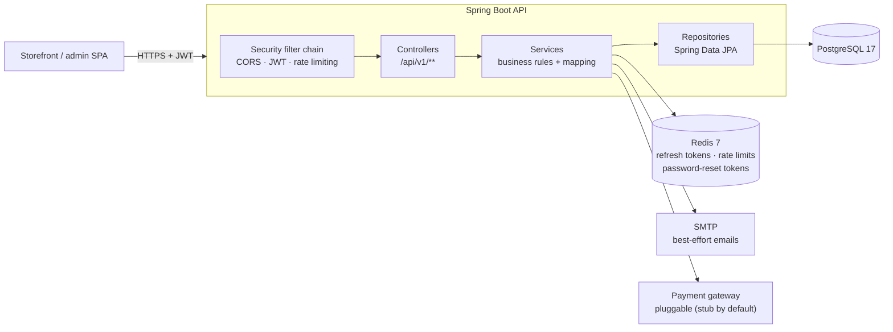
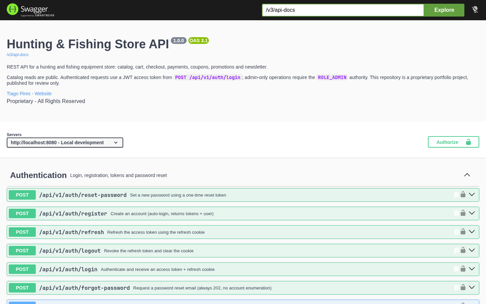

# Hunting & Fishing Store


A Spring Boot 4 / Java 21 backend for a hunting and fishing equipment store:
catalog, cart, checkout, payments, coupons, promotions and newsletter — with a
stateless JWT security model and support for regulated products.

> **Portfolio project.** This repository is published for review purposes only
> and is **not open source** — see [License / Usage](#license--usage).

## About this project

Hunting and fishing gear is not a plain e-commerce domain: some products are
legally regulated and can only be sold to customers who prove they hold the
right license. This backend models that reality end to end — from catalog and
stock through cart, checkout, payment and fulfilment — while keeping the API
stateless and the domain packages independent.

The interesting parts, in rough order of complexity:

- **Regulated checkout.** Products flagged `requiresLicense` are validated
  against the buyer's hunting/fishing license before anything is persisted.
- **Payments.** A pluggable gateway abstraction with a stub implementation,
  four payment methods (MBWAY, Multibanco, card, Klarna), signature-verified
  idempotent webhooks, and a scheduled job that expires overdue Multibanco
  references.
- **Security.** Short-lived JWT access tokens, refresh tokens in HttpOnly
  cookies with Redis-backed revocation, role-based access control, and
  Redis-backed rate limiting on the public authentication endpoints.
- **Localized catalog.** Category and product content is stored per locale
  (`en`, `pt`) with the canonical columns as a fallback; product search honours
  `Accept-Language`.

**Scope:** this is the backend only. The storefront/admin SPA lives in a
separate repository; the payment gateway is a stub, not a live PSP integration.

## Feature highlights

| Area | What it covers |
|---|---|
| **Auth & accounts** | Registration (auto-login + welcome email), login, refresh, logout, `/auth/me`, password reset with one-time tokens, profile updates, address book, RBAC (`ROLE_USER` / `ROLE_ADMIN`) |
| **Catalog** | Products with purchasable variants, brands, hierarchical categories, localized content (en/pt), images, stock movements, pagination/filtering/search |
| **Cart & checkout** | Persistent per-user cart, stock validation, license enforcement, shipping rules, coupons, enforced order status transitions |
| **Payments** | MBWAY, Multibanco, credit card and Klarna via a pluggable gateway; signed idempotent webhooks; expiry scheduler |
| **Marketing** | Coupons with usage limits, active promotions, newsletter subscribe/unsubscribe plus admin filtering, stats, status toggle and CSV export |
| **Operations** | Flyway migrations, Actuator health/metrics, OpenAPI/Swagger UI, ECS structured logs in `prod`, Testcontainers test tiers |

## Architecture

The application is a **modular monolith** organized by business capability. Every
feature package owns its `controller/`, `service/`, `repository/`, `entity/` and
`dto/` layers, so domains stay cohesive and easy to navigate.



Request flow: `Controller → Service → Repository`, with DTO mapping inside the
services. Controllers stay thin (validation + delegation) and never touch
repositories directly; mapping and business rules live in the service layer.

### Package structure

```
src/main/java/com/tiagofsps/hunting_fishing_store/
├── auth/           # JWT, refresh tokens, login/registration, password reset
├── cart/           # Persistent shopping cart
├── catalog/        # Products, brands, categories, translations, stock
├── common/         # BaseEntity, exceptions, shared DTOs, seeding, mail
├── config/         # Security, payment/shipping properties, seeding
├── coupon/         # Coupons and usage tracking
├── newsletter/     # Subscriptions and admin management
├── order/          # Orders, checkout, status transitions
├── payment/        # Payment orchestration and gateway abstraction
├── promotion/      # Promotions and rules
└── user/           # Profiles, addresses, roles
```

## Tech stack

- **Language / runtime:** Java 21
- **Framework:** Spring Boot 4.1 (Web MVC, Data JPA, Validation, Mail, Actuator)
- **Security:** Spring Security, OAuth2 Resource Server (JWT), method security
- **Database:** PostgreSQL 17 (primary), Redis 7 (revocation, rate limits, reset tokens)
- **Migrations:** Flyway (`V1`–`V7`)
- **API docs:** springdoc-openapi 3.x — Swagger UI at `/swagger-ui.html`
- **Testing:** JUnit 5, Mockito, Testcontainers (PostgreSQL + Redis)
- **Build:** Maven wrapper (`./mvnw`)

## Quickstart

**Prerequisites:** Java 21, Docker (for PostgreSQL/Redis), and `make` + `psql`
only if you want the database lifecycle targets.

```bash
git clone git@github.com:tiagofsps/hunting-fishing-store.git
cd hunting-fishing-store

cp .env.example .env          # optional local overrides
docker compose up -d          # PostgreSQL 17 + Redis 7

./mvnw spring-boot:run
```

The API starts on `http://localhost:8080`. Useful URLs:

| URL | What |
|---|---|
| http://localhost:8080/swagger-ui.html | Interactive API docs |
| http://localhost:8080/v3/api-docs | OpenAPI JSON |
| http://localhost:8080/actuator/health | Health and readiness probes |

On an empty database the `dev` profile seeds a demo dataset: users, catalog and
stock. See [Demo accounts](#demo-accounts).

### Full stack in Docker

Build the application image and run it next to PostgreSQL and Redis:

```bash
docker compose --profile full up --build
```

The API is then available on `http://localhost:8080`. The `app` service waits
for both databases to report healthy and runs the `dev` profile, so the demo
dataset is seeded on an empty database. Plain `docker compose up -d` still
starts only the infrastructure, which is what the host-based workflow above
expects.

### Demo accounts

On a fresh `dev` database the seeder creates two fixed accounts with the generic
password `Password123!`:

| Account | Email | Role | Notes |
|---|---|---|---|
| Admin | `admin@huntingfishing.com` | `ROLE_ADMIN` | Full admin access; overridable via `ADMIN_EMAIL` / `ADMIN_PASSWORD` |
| User | `user@huntingfishing.com` | `ROLE_USER` | Includes demo hunting (`DEMO-HUNT-0001`) and fishing (`DEMO-FISH-0001`) licenses plus shipping/billing addresses |

The 20 additional demo users share the password `password123`.

### Database lifecycle

`make` targets wrap host `psql` (no Docker CLI needed). They source an optional
`.env` and honour `POSTGRES_HOST`, `POSTGRES_PORT`, `POSTGRES_USER`,
`POSTGRES_PASSWORD` and `POSTGRES_DB`.

| Command | Effect |
|---|---|
| `make db-reset` | **Destructive:** drops and recreates the database |
| `make db-seed` | Resets, then starts the app so seeders run (the `dev` profile creates the schema with `ddl-auto: update`) |
| `make db-setup` | Alias for `db-seed` |
| `make db-shell` | Interactive `psql` session |

Seeding only runs on an empty database in the `dev` profile, so a reset followed
by `db-seed` reproduces a consistent dataset.

### Try it with curl

The seeded demo data makes the whole happy path runnable in under a minute. Each
step below was executed against a locally running instance.

```bash
BASE=http://localhost:8080/api/v1

# 1. Log in (refresh token is set as an HttpOnly cookie)
TOKEN=$(curl -s -X POST $BASE/auth/login \
  -H 'Content-Type: application/json' \
  -d '{"email":"user@huntingfishing.com","password":"Password123!"}' \
  | python3 -c 'import sys,json;print(json.load(sys.stdin)["accessToken"])')

# 2. Read the demo profile (their id and shipping address id)
curl -s -H "Authorization: Bearer $TOKEN" $BASE/auth/me
```

```bash
# 3. Add a product to the cart (ids from steps 2 and the catalog)
curl -s -X POST $BASE/carts/22/items \
  -H "Authorization: Bearer $TOKEN" -H 'Content-Type: application/json' \
  -d '{"productItemId":24,"quantity":1}'

# 4. Check out (201, order is PENDING, cart is emptied)
curl -s -X POST $BASE/orders/checkout/22 \
  -H "Authorization: Bearer $TOKEN" -H 'Content-Type: application/json' \
  -d '{"shippingAddressId":23,"billingAddressId":23}'

# 5. Pay for it (201; the amount comes from the order, never the client)
curl -s -X POST $BASE/payments \
  -H "Authorization: Bearer $TOKEN" -H 'Content-Type: application/json' \
  -d '{"orderId":2,"paymentMethod":"MBWAY","mbwayPhone":"351912345678"}'
```

The ids in steps 3–5 come from the demo dataset; substitute the values returned
in step 2 and by `GET /products`.

## Configuration

All settings are environment-driven; defaults keep local development working.

| Variable | Default | Description |
|---|---|---|
| `SPRING_PROFILES_ACTIVE` | `dev` | Active Spring profile |
| `DATABASE_URL` / `DATABASE_USER` / `DATABASE_PASSWORD` | `jdbc:postgresql://localhost:5432/hunting_fishing_store` / `postgres` / `postgres` | PostgreSQL connection |
| `REDIS_HOST` / `REDIS_PORT` / `REDIS_PASSWORD` | `localhost` / `6379` / *(empty)* | Redis connection |
| `JWT_SECRET_KEY` | — | HMAC secret for signing JWTs (required in `prod`) |
| `JWT_ACCESS_EXPIRATION` | `15m` | Access-token TTL |
| `JWT_REFRESH_EXPIRATION_SECONDS` | `604800` | Refresh-token TTL (seconds) |
| `CORS_ALLOWED_ORIGINS` | `http://localhost:5173` | Allowed frontend origins |
| `RATE_LIMIT_MAX_ATTEMPTS` / `RATE_LIMIT_WINDOW_SECONDS` | `5` / `900` | Login/register/forgot-password throttle |
| `COOKIE_SECURE` / `COOKIE_SAME_SITE` | `false` / `Strict` | Refresh-token cookie flags |
| `SHIPPING_FREE_THRESHOLD` / `SHIPPING_FEE` | `75` / `4.95` | Free-shipping threshold and flat fee |
| `PASSWORD_RESET_BASE_URL` | `http://localhost:5173/reset-password` | Frontend base URL used in reset emails |
| `ADMIN_EMAIL` / `ADMIN_PASSWORD` | *(empty)* | Override the seeded admin credentials (default `admin@huntingfishing.com` / `Password123!`); required in `prod` |
| `PAYMENT_GATEWAY` | `stub` | Payment gateway implementation (`stub` for now) |
| `PAYMENT_WEBHOOK_SECRET` | `local-webhook-secret-change-me` | Shared secret used to verify webhook signatures |
| `PAYMENT_CHECKOUT_BASE_URL` | `http://localhost:5173` | Base URL for hosted checkout (Klarna/card) |
| `PAYMENT_MULTIBANCO_ENTITY` / `PAYMENT_MULTIBANCO_EXPIRY_HOURS` | `21345` / `48` | Multibanco entity and reference expiry window |
| `PAYMENT_EXPIRY_CRON` | `0 0 * * * *` | Cron schedule for expiring overdue Multibanco references |
| `MAIL_FROM` | — | Sender address for emails |
| `SPRING_MAIL_HOST` / `SPRING_MAIL_PORT` / `SPRING_MAIL_USERNAME` / `SPRING_MAIL_PASSWORD` | *(empty)* | SMTP settings (emails disabled when host is empty) |
| `STRUCTURED_LOG_FORMAT` | `ecs` | Structured log format in `prod` |

## API reference

Base path `/api/v1`. Interactive documentation: `/swagger-ui.html` (OpenAPI JSON
at `/v3/api-docs`). `[ADMIN]` marks endpoints that require `ROLE_ADMIN`.



<details>
<summary><strong>Authentication & users</strong></summary>

- `POST /auth/register` — create an account (auto-login, welcome email)
- `POST /auth/login` — access token in the body, refresh token in an HttpOnly cookie
- `POST /auth/refresh` — rotate the access token using the refresh cookie
- `POST /auth/logout` — revoke the refresh token and clear the cookie
- `GET /auth/me` — current user profile
- `POST /auth/forgot-password` — always `202`, rate-limited, no user enumeration
- `POST /auth/reset-password` — set a new password with a one-time token (15 min TTL)
- `GET /users` — [ADMIN] paginated user list
- `GET /users/{id}` — profile (owner or ADMIN; includes addresses and role)
- `PUT /users/{id}` — update profile
- `POST /users/{id}/password` — change password (owner only)
- `POST /users/{id}/addresses` — add an address
- `PUT /users/{id}/addresses/{addressId}` — update an address
- `DELETE /users/{id}/addresses/{addressId}` — delete an address

</details>

<details>
<summary><strong>Catalog</strong></summary>

**Products**

- `GET /products` — paginated list; query params `page`, `size` (1–100),
  `sort` (`name`|`createdAt`), `direction` (`asc`|`desc`), `categoryId`,
  `brandId`, `q`. Search matches localized content via `Accept-Language`
  (`en` default, `pt` supported). Returns a Spring `Page` envelope
  (`content`, `totalElements`, `totalPages`, …).
- `GET /products/{id}` — details
- `POST /products` — [ADMIN] create
- `PUT /products/{id}` — [ADMIN] update
- `DELETE /products/{id}` — [ADMIN] delete

**Brands**

- `GET /brands` / `GET /brands/{id}` — public reads
- `POST`, `PUT`, `DELETE` — [ADMIN]

**Categories**

- `GET /categories` — list, each with `productCount`
- `GET /categories/{id}` — details
- `POST`, `PUT`, `DELETE` — [ADMIN]

**Stock**

- `POST /stock-movements` — [ADMIN] record a movement
- `GET /stock-movements/item/{productItemId}` — [ADMIN] movement history

Category and product responses include a locale-keyed `translations` map
(`{ "en": { "name", "description" }, "pt": { … } }`), and create/update requests
accept the same shape.

</details>

<details>
<summary><strong>Cart & orders</strong></summary>

- `GET /carts/{userId}` — retrieve the cart
- `POST /carts/{userId}/items` — add an item
- `PUT /carts/{userId}/items/{productItemId}` — update quantity
- `DELETE /carts/{userId}/items/{productItemId}` — remove an item
- `DELETE /carts/{userId}` — clear the cart
- `POST /orders/checkout/{userId}` — place an order from the cart (confirmation email)
- `GET /orders/user/{userId}` — order history
- `GET /orders/{orderNumber}` — order details
- `GET /orders` — [ADMIN] paginated list, optional `status` filter
- `PATCH /orders/{orderNumber}/status?status=…` — [ADMIN] transition status

**Checkout rules**

- **Stock validation** runs for every line before anything is persisted;
  insufficient stock aborts the whole checkout.
- **License enforcement:** `requiresLicense` products need the matching license
  on the buyer's profile (`huntingLicenseNumber` for `HUNTING`,
  `fishingLicenseNumber` for `FISHING`; legacy products without a `licenseType`
  accept either).
- **Shipping:** a flat fee applies below the free-shipping threshold, computed
  on the subtotal before the coupon discount.
- **Status transitions:** `PENDING → PAID|CANCELLED`, `PAID → SHIPPED|CANCELLED`,
  `SHIPPED → DELIVERED`; `DELIVERED` and `CANCELLED` are terminal. Cancelling
  records reverse (`RETURN`) stock movements for every line item.

</details>

<details>
<summary><strong>Payments</strong></summary>

- `POST /payments` — initiate a payment (amount comes from the order server-side, never the client)
- `GET /payments/{id}` — payment status
- `PATCH /payments/{id}/status` — [ADMIN] update status
- `POST /payments/webhook` — provider callback (signature-verified)

Methods: `MBWAY` (requires `mbwayPhone`), `MULTIBANCO` (returns
`multibancoEntity`/`multibancoReference` with a 48h expiry), `CREDIT_CARD` and
`KLARNA` (hosted `paymentUrl`). The gateway is pluggable via `PAYMENT_GATEWAY`
(`stub` by default).

Behaviour: only a `PENDING` order can be paid and only one pending payment per
order is allowed; completion (admin update or webhook) transitions the order to
`PAID`; the webhook is idempotent; overdue Multibanco references are marked
`EXPIRED` by a scheduled job.

</details>

<details>
<summary><strong>Coupons, promotions & newsletter</strong></summary>

- `POST /coupons` — [ADMIN] create
- `GET /coupons` / `GET /coupons/{id}` — [ADMIN] read
- `POST /promotions` — [ADMIN] create
- `GET /promotions` — public list of active promotions
- `GET /promotions/{id}` — details
- `DELETE /promotions/{id}` — [ADMIN] delete
- `POST /newsletter/subscribe` — public subscribe
- `DELETE /newsletter/subscribe` — public unsubscribe
- `GET /newsletter/subscriptions` — [ADMIN] paginated list, optional `active` and `q` filters
- `GET /newsletter/subscriptions/stats` — [ADMIN] active subscriber count
- `PATCH /newsletter/subscriptions/{id}` — [ADMIN] activate/deactivate
- `DELETE /newsletter/subscriptions/{id}` — [ADMIN] delete
- `GET /newsletter/subscriptions/export` — [ADMIN] CSV export

</details>

<details>
<summary><strong>Operations</strong></summary>

- `GET /actuator/health` — public health/liveness/readiness probes
- `GET /actuator/metrics` — [ADMIN] metrics
- `GET /actuator/info` — [ADMIN] build info
- `GET /v3/api-docs` — OpenAPI JSON
- `GET /swagger-ui.html` — Swagger UI

</details>

## Security model

- **Stateless authentication.** Short-lived JWT access tokens travel in the
  `Authorization: Bearer` header; long-lived refresh tokens live in secure,
  HttpOnly, SameSite cookies.
- **Revocation.** Refresh-token IDs are tracked in Redis, so logout and
  suspicious-session invalidation take effect immediately.
- **RBAC.** `ROLE_USER` and `ROLE_ADMIN` with method-level `@PreAuthorize`.
  Catalog reads (products, brands, categories, promotions) are public; writes
  are admin-only.
- **Rate limiting.** A Redis-backed sliding window limits per-IP attempts on the
  public POST endpoints (`/auth/login`, `/auth/register`, `/auth/refresh`,
  `/auth/forgot-password`, `/newsletter/subscribe`) and returns `429`. Per-email
  limits are enforced in the controllers without leaking account existence.
- **CORS** is configurable (`CORS_ALLOWED_ORIGINS`) with credentials enabled.
- **Passwords** are BCrypt-hashed; HSTS is on, frame options are `DENY`, and
  CSRF is disabled for the stateless API.

## Emails & observability

Transactional emails are sent best-effort through Spring Mail when an SMTP host
is configured; failures are logged and never block the business flow. Emails:
welcome on registration, order confirmation on checkout, password reset link.
Without a configured host, emails are logged to the console.

Actuator exposes `health`, `info` and `metrics`, with liveness/readiness probes
for orchestration. The `prod` profile enables ECS structured JSON logging.

## Testing

The suite contains **319 tests across 53 classes**, with JaCoCo reporting **78%
line coverage** at the `v1.0.0` snapshot. It is split into four tiers that mirror
the feature packages:

| Tier | Style | Requires Docker |
|---|---|---|
| Unit | JUnit 5 + Mockito, no Spring context | No |
| Repository | `@DataJpaTest` against the real database | Yes |
| Controller | `MockMvc` with mocked services | Yes |
| Integration | `@SpringBootTest` end to end through `MockMvc` | Yes |

```bash
./mvnw test            # full suite (Testcontainers needs Docker)
./mvnw clean verify    # what CI runs
```

`verify` also writes a JaCoCo coverage report to
`target/site/jacoco/index.html`; CI uploads it alongside the surefire reports.
The build fails fast on the wrong toolchain: Maven Enforcer requires Java 21+
and Maven 3.9+.

The container-backed tiers extend `AbstractContainerBaseTest`, which starts a
PostgreSQL and a Redis container once per JVM and wires them via
`@ServiceConnection`. See the [Testing Guide](docs/testing.md) for the base
classes and conventions.

## Documentation

- [Development Guide](docs/development.md) — profiles, running the app, database
  lifecycle, configuration and common pitfalls.
- [Testing Guide](docs/testing.md) — test tiers, base classes and conventions.
- [Architecture](docs/architecture/README.md) — domain model, technology stack,
  design decisions and coding conventions.
- [Changelog](CHANGELOG.md) — notable changes by release.
- [Security Policy](SECURITY.md) — how to report a vulnerability privately.

## License / Usage

This repository is published for **portfolio and review purposes only** and is
**not open source**. It is proprietary: all rights reserved. See [LICENSE](LICENSE)
for the full notice. No permission is granted to use, copy, modify, or
distribute the code without prior written permission from the copyright holder.
